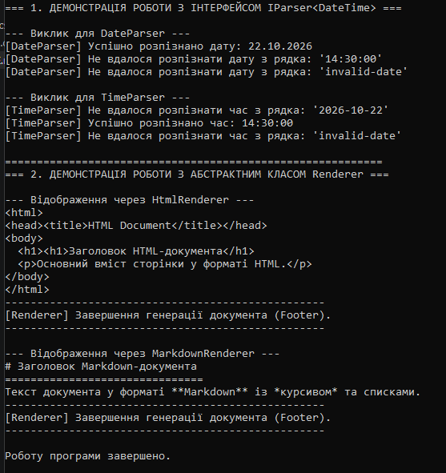

# Лабораторна робота №10: Абстрактні класи та інтерфейси. Контракти та реалізації

**призвище та імя** Довмат Максим
**Варіант:** №8  
**Тема:** Абстрактні класи та інтерфейси. Контракти та реалізації.

## 1. Мета роботи
Навчитися створювати та використовувати абстрактні класи та інтерфейси для визначення контрактів і реалізації спільної логіки, а також зрозуміти критерії вибору між ними в мові C# (.NET).

## 2. Опис реалізованої структури (Варіант №8)

## 3. Демонстрація роботи та поліморфізму (`Program.cs`)

1. Основна відмінність: Абстрактний клас описує зв'язок "is-a" (є чимось) і може містити стан (поля), конструктори та готову логіку. Інтерфейс описує поведінку "can-do" (вміє робити) і є чисто контрактом без стану чи конструкторів.

2. Сфера застосування та приклади:

Абстрактний клас: використовується для тісно пов'язаних класів зі спільною логікою (наприклад, Renderer містить спільний для всіх типів метод RenderFooter()).

Інтерфейс: використовується для визначення однакової поведінки у різних, не пов'язаних між собою класів (наприклад, IParser<T> визначає єдиний метод Parse() для різних парсерів).

3. Множинне успадкування: У C# клас не може успадковувати більше ніж один абстрактний клас, але може реалізовувати довільну кількість інтерфейсів одночасно.

4. Вплив на архітектуру: Вони дозволяють коду працювати з об'єктами через високорівневі абстракції (List<IParser<T>>, List<Renderer>), що дає змогу додавати нові реалізації без редагування існуючого коду (принцип Open/Closed у SOLID).

