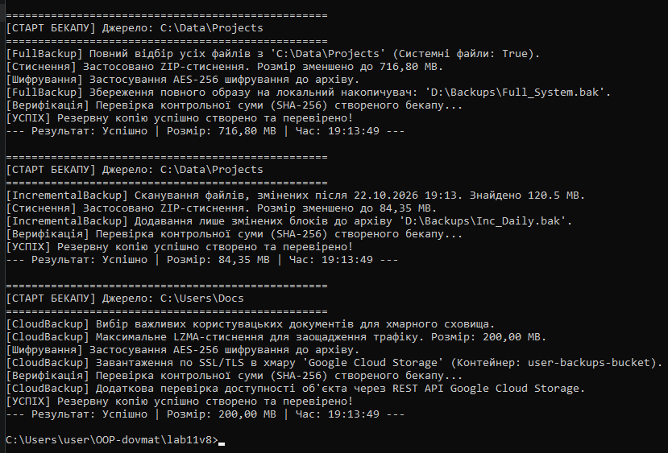

# Лабораторна робота №11: BackupService (Template Method)

**Виконав:** Довмат Максим  
**Репозиторій:** https://github.com/maks1dv/OOP-Dovmat  
**Проєкт:** `lab11v8`  
**Варіант:** 8 (BackupService)

## Похідні класи:
- `FullBackup`
- `IncrementalBackup` 
- `CloudBackup` 

---

### 4. Відповіді на контрольні запитання

1. Template Method — поведінковий паттерн, який визначає скелет алгоритму в базовому класі, дозволяючи похідним класам змінювати конкретні кроки без зміни загальної структури.

2. Різниця методів:

Абстрактні (abstract) — обов'язкові кроки без реалізації в базовому класі, які похідні класи мусять написати самі.

Віртуальні (virtual) — опціональні кроки, що мають базову реалізацію за замовчуванням і перевизначаються лише за потреби.

3. Переваги базового класу: відсутність дублювання коду (принцип DRY), гарантія суворого порядку виконання кроків та легке розширення новими класами.

4. Замість інтерфейсів: використовується тоді, коли між об'єктами є не просто спільний контракт, а спільна реалізація коду, єдиний алгоритм та спільний стан (властивості).

5. Приклад з життя: Автоматична мийка авто — послідовність дій завжди стала (Заїзд → Нанесення піни → Змивання → Сушка → Виїзд), але виконання окремих кроків варіюється залежно від обраної програми.
