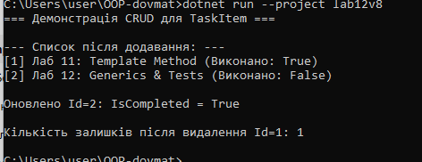
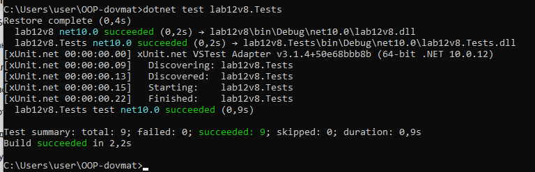

# Лабораторна робота №12: Generics, IRepository та xUnit Тести

**Виконав:** Довмат Максим  
**Репозиторій:** https://github.com/maks1dv/OOP-Dovmat  
**Проєкти:** `lab12v8` та `lab12v8.Tests`  
**Варіант:** 8 (`TaskItem`)

## 3. Відповіді на контрольні запитання

1. **Яка роль where-обмежень у Generics?**  
   Обмеження `where` звужують типи, які можна передати як аргумент шаблону, гарантуючи наявність необхідних властивостей/методів (наприклад, `where T : IEntity` гарантує наявність поля `Id`).

2. **Навіщо потрібен шаблон IRepository? Які переваги він дає?**  
   Абстрагує логіку доступу до даних від бізнес-логіки. Дозволяє легко змінювати сховище (наприклад, замінити `InMemory` на БД) без зміни коду програми.

3. **Поясніть, чому юніт-тести є важливими при розробці узагальнених компонентів.**  
   Оскільки узагальнені класи працюють із будь-якими типами даних, тести гарантують стабільність базових механізмів (CRUD, валідація, виключення) незалежно від конкретної сутності.

4. **Які проблеми вирішують Generics порівняно з використанням object?**  
   Забезпечують строгу типізацію на етапі компіляції, підвищують продуктивність (відсутність `boxing/unboxing` для value types) та усувають потребу в явних приведеннях типів.

   
   