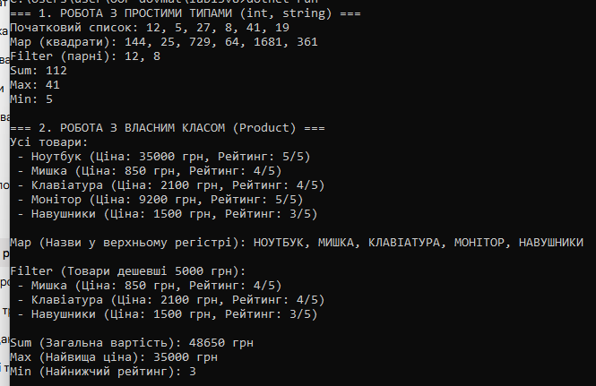

# Лабораторна робота №13: Generic-методи для повторного використання компонентів

**призвище:**  Довмат Максим
**Варіант:** №8  

## 1. Реалізовані generic-методи у класі `FunctionalUtils`
1. **`Map<T, TResult>(List<T>, Func<T, TResult>)`** — перетворює елементи списку з одного типу в інший.
2. **`Filter<T>(List<T>, Func<T, bool>)`** — фільтрує елементи за переданою умовами (предикатом).
3. **`Sum<T>(List<T>, Func<T, double>)`** — підраховує суму вибраного числового поля елементів.
4. **`Max<T, TKey>(List<T>, Func<T, TKey>) where TKey : IComparable<TKey>`** — знаходить максимальне значення заданого поля.
5. **`Min<T, TKey>(List<T>, Func<T, TKey>) where TKey : IComparable<TKey>`** — знаходить мінімальне значення заданого поля.

## 5. Відповіді на контрольні запитання

1. **Що таке generic-методи і які переваги вони дають?**  
   Generic-методи — це методи, параметр типу яких визначається під час виклику. Вони гарантують типобезпеку, усувають потребу в дублюванні коду для різних типів та уникають продуктивноємних операцій упаковки/розпаковки (boxing/unboxing).

2. **Яка різниця між делегатами `Func<T>` та `Action<T>`?**  
   * `Func<T, TResult>` завжди повертає значення вказаного типу (`TResult`).
   * `Action<T>` використовується для методів, які не повертають значення (`void`).

3. **Що таке функції вищого порядку? Наведіть приклади.**  
   Це функції, які приймають інші функції як параметри або повертають їх як результат (*наприклад, `Map`, `Filter`, `Sum`, які приймають лямбда-вирази як параметри*).

4. **Навіщо потрібні обмеження (constraints) для generic типів?**  
   Обмеження (наприклад, `where TKey : IComparable<TKey>`) вказують компілятору, які властивості чи методи має підтримувати тип. Без цього обмеження ми не змогли б викликати метод порівняння `.CompareTo()` у методах `Max` та `Min`.

5. **Як лямбда-вирази спрощують роботу з делегатами?**  
   Лямбда-вирази (наприклад, `x => x.Price < 5000`) дозволяють записувати анонімні функції лаконічно в один рядок без створення окремих іменованих методів.

   