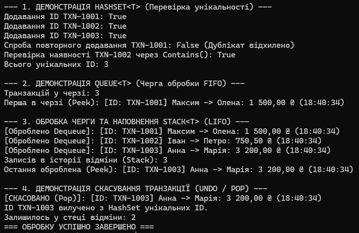

# Лабораторна робота №14: HashSet/Queue/Stack (Варіант 8 — Обробка транзакцій)

**Виконав:** Довмат Максим  
**Репозиторій:** https://github.com/maks1dv/OOP-Dovmat  
**Проєкт:** `lab14v8`  

## 1. Опис роботи та використання колекцій
У лабораторній роботі змодельовано систему обробки банківських транзакцій, яка демонструє типові сценарії застосування спеціалізованих колекцій:

1. **`HashSet<string>` (Унікальні ID транзакцій)**:
   - Забезпечує перевірку унікальності та швидке відхилення дублікатів за $O(1)$ часу.
   - Методи: `Add()`, `Contains()`, `Remove()`.
2. **`Queue<Transaction>` (Черга обробки — FIFO)**:
   - Дисципліна *First In, First Out* гарантує обробку транзакцій у порядку їх надходження.
   - Методи: `Enqueue()`, `Dequeue()`, `Peek()`.
3. **`Stack<Transaction>` (Історія для відміни — LIFO)**:
   - Дисципліна *Last In, First Out* зберігає оброблені транзакції, дозволяючи швидко скасувати останню виконану дію (Undo).
   - Методи: `Push()`, `Pop()`, `Peek()`.

## 3. Відповіді на контрольні запитання

1. **List проти HashSet:** `List<T>` зберігає дублікати та шукає за $O(n)$, `HashSet<T>` зберігає лише унікальні елементи та шукає за $O(1)$.
2. **Коли Queue замість List:** для обробки елементів у порядку надходження (FIFO) без витратного зсуву масиву при видаленні з початку.
3. **Приклад для Stack:** функція відміни дій (Undo/Redo) у редакторах або стек викликів методів.
4. **Складність Contains() у HashSet:** $O(1)$ в середньому, бо пошук виконується за хеш-кодом (`GetHashCode()`).
5. **FIFO проти LIFO:**
   - **FIFO** (*First In, First Out*) — перший увійшов, перший вийшов (черга).
   - **LIFO** (*Last In, First Out*) — останній увійшов, перший вийшов (стек).

