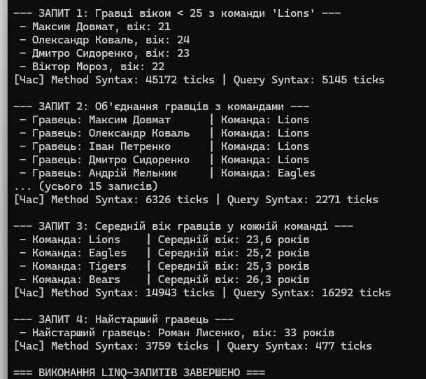

# Лабораторна робота №15: LINQ в дії (Варіант 8 — Спортивна ліга)

**Виконав:** Довмат Максим  
**Репозиторій:** https://github.com/maks1dv/OOP-Dovmat  
**Проєкт:** `lab15v8`  
**Варіант:** 8

---

## 1. Опис структури та реалізації
У лабораторній роботі реалізовано 2 класи сутностей:
- **`Team`** (`Id`, `Name`, `City`) — спортивна команда.
- **`Player`** (`Id`, `Name`, `TeamId`, `Age`) — гравець ліги.

Створено тестові колекції (4 команди та 15 гравців) та реалізовано 4 LINQ-запити в двох синтаксисах (**Method Syntax** та **Query Syntax**) із заміром часу через `System.Diagnostics.Stopwatch`.

## 3. Відповіді на контрольні запитання

1. **Query Syntax vs Method Syntax:** Query Syntax нагадує SQL (`from ... where`), зручний для Join. Method Syntax використовує лямбда-вирази (`.Where()`) і надає доступ до повного функціоналу LINQ.
2. **Join vs GroupJoin:** `Join` — внутрішнє об'єднання елементів (INNER JOIN), `GroupJoin` — ієрархічне об'єднання з групуванням (LEFT JOIN).
3. **Агрегуючі операції:** `Count()`, `Sum()`, `Average()`, `Min()`, `Max()`, `Aggregate()`.
4. **Продуктивність:** Вимірюється через `Stopwatch`. Залежить від негайного/відкладеного виконання, обсягу даних та складності алгоритму.

