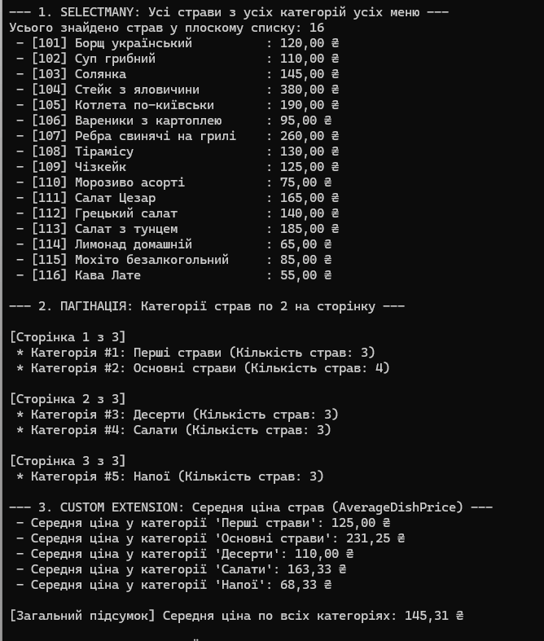

# Лабораторна робота №16: LINQ: SelectMany, пагінація та custom extensions

**Виконав:** Довмат Максим  
**Репозиторій:** https://github.com/maks1dv/OOP-Dovmat  
**Проєкт:** `lab16v8`  
**Варіант:** 8 (Меню ресторану та його категорії страв)

---

## 1. Опис структури та реалізації
У лабораторній роботі створено структуру даних із вкладеними колекціями:
- **`RestaurantMenu`** містить список категорій `List<DishCategory>`.
- **`DishCategory`** містить список страв `List<Dish>`.
- **`Dish`** (`Id`, `Name`, `Price`).

### Виконані підзадачі:
1. **`SelectMany`**: «Розгортання» трирівневої вкладеної структури у єдиний плоский список усіх страв `List<Dish>`.
2. **Пагінація**: Посторінковий вивід категорій страв по 2 категорії на сторінку за допомогою `Skip((page - 1) * pageSize).Take(pageSize)`.
3. **Custom Extension Method**: Створено метод розширення `AverageDishPrice()` для `IEnumerable<DishCategory>` та `DishCategory`, що обчислює середню ціну страв.

## 3. Відповіді на контрольні запитання

1. **Для чого SelectMany та його відмінність від Select?**  
   `Select` трансформує кожен елемент у новий об'єкт, повертаючи вкладену колекцію `IEnumerable<List<T>>`. `SelectMany` спрощує (flattening) вкладені колекції в один плоский список `IEnumerable<T>`.

2. **Як реалізувати пагінацію у LINQ?**  
   Використовуються методи `Skip()` та `Take()`. Формула сторінки: `collection.Skip((pageNumber - 1) * pageSize).Take(pageSize)`.

3. **Концепція методів розширення (Extension Methods):**  
   Це статичні методи статичного класу з модифікатором `this` перед першим параметром, які дозволяють додавати нову функціональність до існуючих типів (наприклад, `IEnumerable<T>`) без їхньої модифікації.

4. **Приклад власного методу розширення:**  
   `AverageDishPrice(this IEnumerable<DishCategory> categories)` — збирає усі страви з категорій через `SelectMany` та обчислює середнє значення через `.Average(d => d.Price)`.

