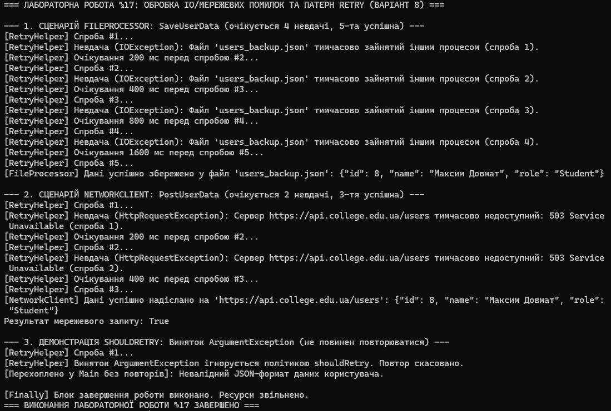

# Лабораторна робота №17: Обробка IO/мережевих помилок та патерн Retry

**Виконав:** Довмат Максим  
**Репозиторій:** https://github.com/maks1dv/OOP-Dovmat  
**Проєкт:** `lab17v8`  
**Варіант:** 8 (Збереження даних користувача)

---

## 1. Опис структури та реалізації
У лабораторній роботі реалізовано систему відмовостійкого збереження та передачі даних користувача:
- **`FileProcessor`**: метод `SaveUserData(string path, string userData)` імітує тимчасове блокування файлу (`IOException`) перші 4 рази, після чого успішно виконується на 5-й спробі.
- **`NetworkClient`**: метод `PostUserData(string url, string userData)` імітує мережевий збій (`HttpRequestException`) перші 2 рази, після чого успішно відправляє дані на 3-й спробі.
- **`RetryHelper`**: узагальнений статичний клас із методом `ExecuteWithRetry<T>`, що реалізує експоненційну затримку, логування спроб і вибіркову фільтрацію винятків через делегат `shouldRetry`.

---
## Відповіді на контрольні запитання
1. Типи винятків при роботі з файлами та мережею:

Для файлової системи (I/O): IOException, FileNotFoundException, DirectoryNotFoundException, UnauthorizedAccessException.

Для мережі: HttpRequestException, SocketException, TimeoutException.

2. Принцип роботи патерну Retry та доцільність використання:

Патерн автоматично повторює виконання операції після виникнення помилки задану кількість разів. Доцільно застосовувати лише для тимчасових (transient) збоїв — втрати з'єднання, таймаутів або тимчасового блокування файлу, коли є висока ймовірність успіху при повторному зверненні.

3. Реалізація експоненційної затримки:

Базова затримка множиться на степінь двійки залежно від номера спроби: initialDelay * Math.Pow(2, attempt - 1), після чого потік призупиняється через Thread.Sleep(delay) (або await Task.Delay(delay) в асинхронному коді).

4. Призначення делегата shouldRetry у RetryHelper:

Дозволяє гнучко фільтрувати винятки та визначати, чи має сенс повторювати операцію. Наприклад, тимчасові помилки (IOException, HttpRequestException) повторюються, тоді як логічні помилки (ArgumentException, NullReferenceException) одразу прокидаються далі без марного витрачання часу.

