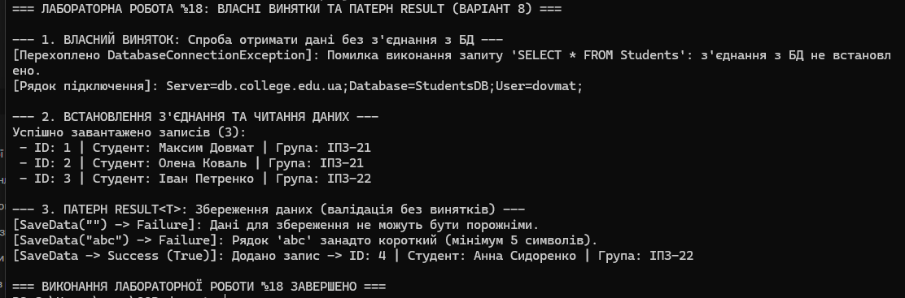

# Лабораторна робота №18: Власні винятки та патерн Result

**Виконав:** Довмат Максим  
**Репозиторій:** https://github.com/maks1dv/OOP-Dovmat  
**Проєкт:** `lab18v8`  
**Варіант:** 8 (Робота з базою даних — імітація)

---

## 1. Опис структури та реалізації
У лабораторній роботі реалізовано комбінований підхід до обробки помилок при роботі з базою даних:
- **`DatabaseConnectionException`**: власний клас винятку, успадкований від `Exception` зі стандартними конструкторами та додатковою властивістю `ConnectionString`.
- **`Result<T>`**: узагальнений клас із властивостями `IsSuccess`, `Value`, `Error`, приватним конструктором та фабричними методами `Success(T)`, `Failure(string)` і `Failure(Exception)`.
- **`DataService`**: сервіс роботи з даними, де `GetData(string query)` викидає `DatabaseConnectionException` за відсутності з'єднання, а `SaveData(string data)` повертає `Result<bool>` при порушенні правил валідації вхідних даних.

---

