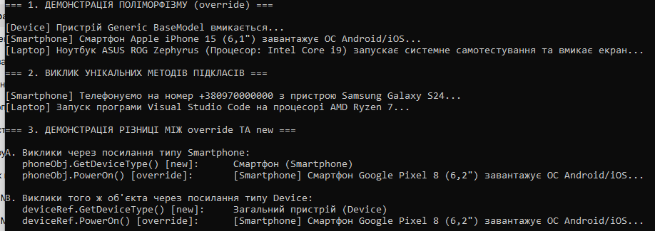

# Лабораторна робота №6: Наслідування. Ключові слова base, override, virtual. Приховування членів (new)

**Студент:** Довмат Максим  
**Варіант:** №8  
**Тема:** Наслідування. Ключові слова base, override, virtual. Приховування членів (new)  
**силка https://github.com/maks1dv/OOP-Dovmat/tree/main/lab6v8   

##  Реалізована ієрархія класів (Варіант 8)

Ієрархія: **`Device` (базовий) → `Smartphone` (похідний) → `Laptop` (похідний)**

1. Наслідування — механізм ООП, коли похідний клас успадковує стан і поведінку базового класу («є-різновидом»).

Приклад: Smartphone та Laptop є різновидами Device.

2. base — звернення до членів батьківського класу з дочірнього.

Застосування: виклик базового конструктора (: base(brand, model)) або базового методу (base.PowerOn()).

3. virtual vs override:

virtual у базовому класі дозволяє перевизначення методу.

override у похідному класі надає його нову реалізацію.

4. Разом вони забезпечують динамічний поліморфізм (пізнє зв'язування): викликається метод фактичного об'єкта в пам'яті.

new (приховування) — явно перериває поліморфізм та перекриває метод базового класу новим.

Наслідок: працює статичне (раннє) зв'язування — викликається метод того типу, який має змінна-посилання, а не сам об'єкт.
