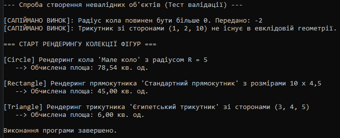

# Лабораторна робота №9: Поліморфні сервіси (Рендеринг фігур)

**Студент:** Максим Довмат  
**Проєкт:** `OOP-ДовматМаксим/lab9v8`  
**Варіант:** №8  
**Тема:** Поліморфні сервіси: Shape (Circle/Rectangle/Triangle)

## 1. Мета роботи
Застосувати поліморфізм для створення системи рендерингу геометрії, реалізувати перевірку/валідацію вхідних даних та навчитися обробляти винятки під час роботи з колекціями базового типу.

## 2. Опис реалізованої структури
- **`Shape`** — абстрактний базовий клас із властивістю `Name` та абстрактними методами `Draw()` і `Area()`.
- **`Circle`** — похідний клас з валідацією `Radius > 0`.
- **`Rectangle`** — похідний клас з валідацією `Width > 0` та `Height > 0`.
- **`Triangle`** — похідний клас з перевіркою `SideA, SideB, SideC > 0` та валідацією нерівності трикутника.
- **`ShapeService`** — клас-сервіс із методом `RenderAll(List<Shape> shapes)`, який здійснює поліморфні виклики та обробляє помилки.

1. Що таке поліморфізм і як він реалізується через спадкування?

Це здатність об'єктів різних класів реалізовувати один і той самий метод по-різному. Реалізується перевизначенням (override) абстрактних або віртуальних методів базового класу.

2. Яка різниця між абстрактним класом та інтерфейсом?

Абстрактний клас може мати стан (поля), конструктори та готову логіку. Інтерфейс — це чистий контракт без стану, але клас може реалізовувати кілька інтерфейсів одночасно.

3. Чому поліморфізм зручний для роботи зі списками різних типів?

Він дозволяє зберігати об'єкти різних похідних типів у єдиному списку (List<Shape>) і викликати їхні методи в циклі без конструкцій if/else.

4. Як обробляти специфічні помилки в поліморфних системах?

Через викидання винятків (throw new ArgumentException) під час валідації в похідних класах та їх перехоплення блоками try-catch.

5. Наведіть приклад з реального життя, де застосовується поліморфізм.

Графічний редактор (Paint): є список фігур Shape, для кожного елемента викликається .Draw(), але коло малює коло, а прямокутник — прямокутник.
